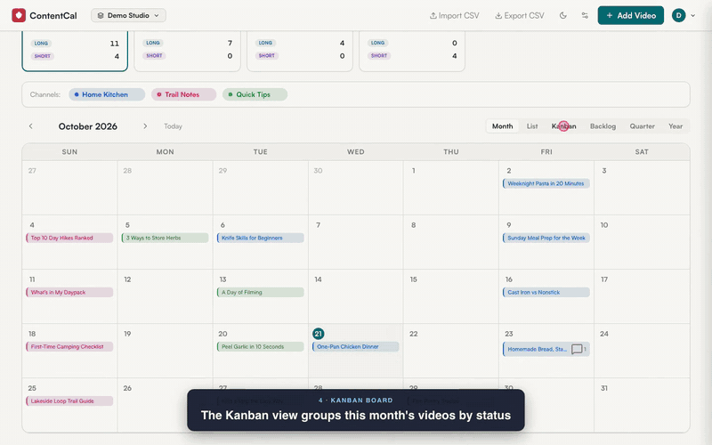

# ContentCal — Self-Hosted YouTube Content Calendar

A lightweight, self-hosted Docker app for planning and tracking video content
across multiple YouTube channels. Multi-user and multi-workspace, with a
six-stage pipeline (Idea → Filming → Editing → Ready → Scheduled → Published),
calendar / board / list / year views, goals, comments, and an activity feed.

Data is stored in a single **SQLite** database file (`calendar.db`) on your NAS.
(Older installs that used a `calendar.json` file are imported automatically on
first start and renamed to `calendar.json.migrated`.)

[](docs/contentcal-demo.mp4)

▶ **[Watch the 90-second demo](docs/contentcal-demo.mp4)** — sign in, add a video, drag it across the board, comment, and switch views.

📚 **Full documentation lives in [`docs/`](docs/):**
[Overview](docs/OVERVIEW.md) · [User Guide](docs/USER_GUIDE.md) · [Developer Guide](docs/DEVELOPER_GUIDE.md)

---

## Features

- 📅 Six views: Month, List, Kanban (drag to change status), Backlog, Quarter, Year
- 🎬 Per-video status pipeline, short/long-form tagging, content pillars, links, notes
- 🎯 Goal tracking with a live progress bar
- 🟣 Up to 6 channels per workspace, each with its own color and profile image
- 🤝 Workspaces with owner/member roles, invite links, comments, and an activity feed
- ⏱️ Timezone-aware auto-publish for scheduled videos
- 📥 CSV import (with column mapping + duplicate detection) and export
- 🌙 Dark mode and responsive mobile layout
- 🔒 Account-based auth (bcrypt + signed session cookies); all data stays on your server

---

## Quick Start

### 1. Set your data path

Edit `docker-compose.yml` and update this line to point to a folder on your NAS:

```yaml
- /your/nas/path/contentcal:/data
```

Example for UGREEN NAS:
```yaml
- /mnt/data/appdata/contentcal:/data
```

### 2. Build and run

```bash
docker compose up -d --build
```

### 3. Open the app

Navigate to: `http://<your-nas-ip>:8765`

Via Tailscale: `http://<nas-tailscale-ip>:8765`

The **first** person to open the app runs a one-time setup wizard that creates
the admin account and the first workspace. After that, sign in with your
account; invite teammates from **Workspace settings**.

> ⚠️ Cookies are sent without the `Secure` flag, so terminate TLS at a reverse
> proxy (or use Tailscale) when exposing this beyond localhost. For multi-replica
> deployments you must set the `SESSION_SECRET` env var.

---

## Portainer Setup

1. In Portainer → **Stacks** → **Add Stack**
2. Upload or paste the contents of `docker-compose.yml`
3. Update the volume path
4. Deploy

---

## Updating

```bash
docker compose pull
docker compose up -d --build
```

---

## Data Backup

Your entire calendar — every workspace, channel, video, comment, and account —
lives in one SQLite file:
```
/your/nas/path/contentcal/calendar.db
```

Back this up with your normal NAS backup routine (rsync, Hyper Backup, etc.).
The same folder also holds a `.session_secret` file; preserving it keeps users
logged in across restarts.

---

## Port

Default: `8765` — change the left side of the port mapping in `docker-compose.yml`:
```yaml
ports:
  - "NEW_PORT:8000"
```

---

## API Endpoints (optional direct access)

The core data routes (all scoped to your active workspace via the session cookie):

| Method | Path | Description |
|--------|------|-------------|
| GET | `/api/data` | Get channels + entries + goal for the active workspace |
| POST | `/api/entries` | Add a new entry |
| PUT | `/api/entries/{id}` | Update an entry |
| DELETE | `/api/entries/{id}` | Delete an entry |
| PUT | `/api/channels` | Update all channels (send `X-Channels-Version` header) |

There are many more routes for auth, workspaces, members, invites, and comments.
See the **[full API reference](docs/DEVELOPER_GUIDE.md#15-api-reference)** in the
Developer Guide, or the interactive OpenAPI docs at:

Interactive API docs: `http://<your-ip>:8765/docs`

---

## Development

The backend has a pytest regression suite (~80 tests, ~30s). Common dev tasks
are wrapped in a top-level `Makefile`:

```bash
make help            # list all targets
make setup           # one-time: install dev deps + wire up the pre-push hook
make test            # run the regression suite
make install-hooks   # (re-)wire the pre-push hook on a fresh clone
```

After `make install-hooks`, every `git push` runs the test suite first and
blocks if anything fails. Bypass in a pinch with `git push --no-verify`.

Tests live in `backend/tests/` — see `backend/tests/README.md` for details.

