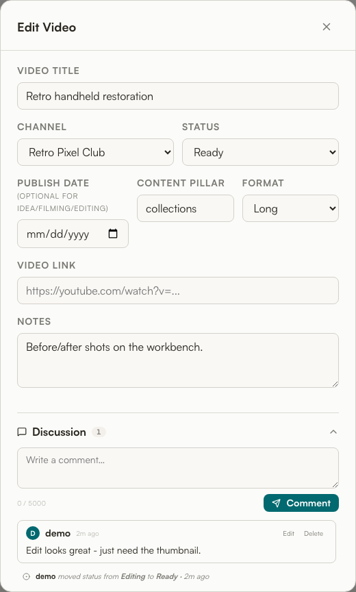
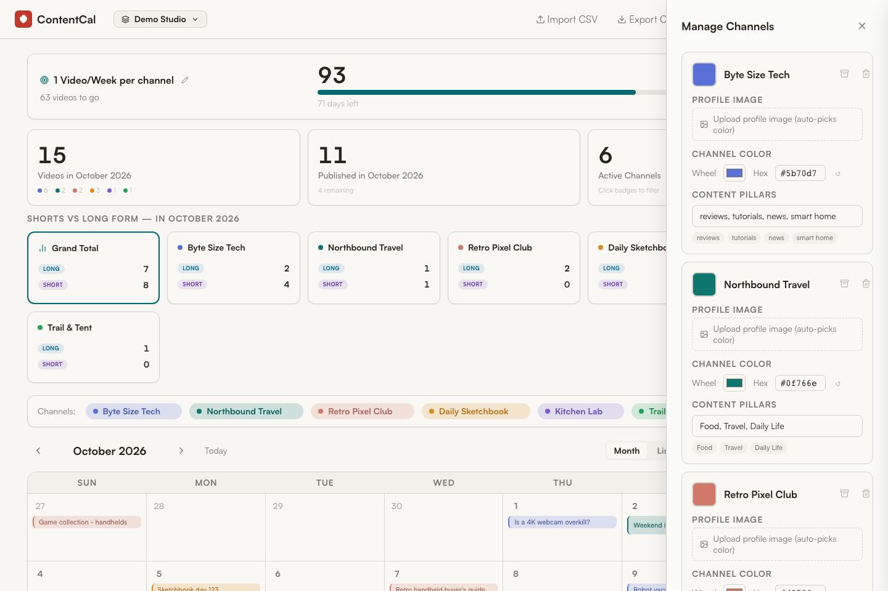
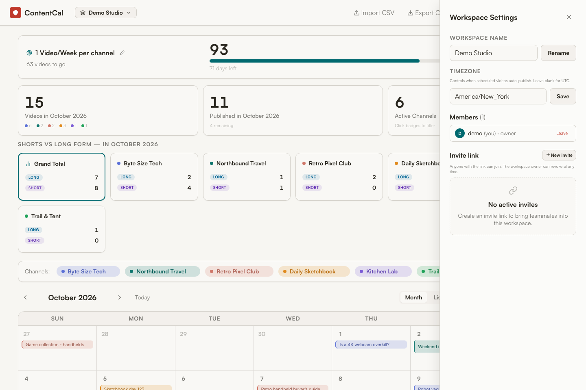

# 🛠️ ContentCal — Developer Guide

Everything you need to run, understand, and extend ContentCal. The whole app is intentionally small: a single-file FastAPI backend (~1,500 LOC) and a single-file vanilla-JS frontend (~2,500 LOC), with **no build step** on either side.

---

## Table of contents

1. [Stack & philosophy](#1-stack--philosophy)
2. [Repository layout](#2-repository-layout)
3. [Running it](#3-running-it)
4. [Architecture overview](#4-architecture-overview)
5. [Data model](#5-data-model)
6. [Multi-tenancy & the workspace scoping rule](#6-multi-tenancy--the-workspace-scoping-rule)
7. [Authentication & sessions](#7-authentication--sessions)
8. [Roles & ownership invariants](#8-roles--ownership-invariants)
9. [Invites](#9-invites)
10. [The positional-channel design & optimistic concurrency](#10-the-positional-channel-design--optimistic-concurrency)
11. [Auto-publish & timezones](#11-auto-publish--timezones)
12. [Discussion: comments + activity feed](#12-discussion-comments--activity-feed)
13. [Validation & limits](#13-validation--limits)
14. [Schema migrations](#14-schema-migrations)
15. [API reference](#15-api-reference)
16. [Frontend notes](#16-frontend-notes)
17. [Testing](#17-testing)
18. [Configuration reference](#18-configuration-reference)
19. [Security notes & hardening](#19-security-notes--hardening)
20. [Extending the app](#20-extending-the-app)

---

## 1. Stack & philosophy

| Layer | Choice |
|---|---|
| Backend | Python 3.12, **FastAPI** + **SQLModel** (SQLAlchemy + Pydantic) |
| Database | **SQLite**, single file on a mounted volume |
| Frontend | One `index.html`, **vanilla JS** — no framework, no bundler, no `node_modules` |
| Auth | **bcrypt** password hashing, **itsdangerous** signed session cookies |
| Packaging | One **Docker** image; frontend served by FastAPI's `StaticFiles` |

**Design philosophy:** keep the entire system inspectable and dependency-light so it can run forever on a home NAS. The frontend is served as static files by the same process that serves the API — same origin, no CORS by default, no separate web server.

---

## 2. Repository layout

```
contentcalv3/
├── backend/
│   ├── main.py            # The entire backend: models, auth, routes
│   ├── Dockerfile         # python:3.12-slim + uvicorn
│   ├── requirements.txt   # fastapi, uvicorn, pydantic, sqlmodel, bcrypt, itsdangerous
│   ├── requirements-dev.txt
│   └── tests/             # ~80 pytest regression tests
├── frontend/
│   └── index.html         # The entire frontend (HTML + CSS + JS)
├── docker-compose.yml     # Maps :8765 -> :8000, mounts ./data at /app/data
├── Makefile               # setup / test / install-hooks
├── README.md
└── data/                  # Runtime data (gitignored)
```

> Data files (`calendar.db`, `.session_secret`, the migrated legacy `calendar.json`) live in `./data` (mounted at `/app/data`) at runtime, **not** in the repo.

---

## 3. Running it

### Docker (production / NAS)

```bash
# ./data (next to docker-compose.yml) is mounted at /app/data
mkdir -p data
docker compose up -d --build
# App: http://<host>:8765   (host 8765 -> container 8000)
```

The compose file bind-mounts `./frontend` to `/frontend` (read-only) and `./backend/main.py` to `/app/main.py`, so you can edit `main.py` and restart the container without rebuilding the image.

### Local development

`main.py` mounts the frontend from the absolute path `/frontend` (see the very last line) and reads/writes `/app/data` by default. The simplest reliable dev loop is therefore Docker, but you can run bare-metal by overriding the env vars and adjusting the static mount:

```bash
cd backend
python -m venv .venv && source .venv/bin/activate
pip install -r requirements-dev.txt
DATA_DIR=./_data uvicorn main:app --reload --port 8000
```

…with the caveat that the `app.mount("/", StaticFiles(directory="/frontend", html=True))` line expects `/frontend` to exist; point it at the repo's `frontend/` (or run in Docker where that path is mounted).

### First run

On an empty database the app seeds three default channels and waits. The first browser to hit it sees `setup_required: true` and runs the one-time setup wizard (`POST /api/auth/setup`), which creates the admin user, their workspace, and **adopts** any pre-existing `workspace_id=0` rows into that workspace.

---

## 4. Architecture overview

```
┌──────────────────────────────────────────────┐
│  Browser (single index.html, vanilla JS)      │
│  fetch() → /api/*   ·   cookie: contentcal_session │
└───────────────┬──────────────────────────────┘
                │ same-origin HTTP
┌───────────────▼──────────────────────────────┐
│  FastAPI (main.py)                            │
│  ├─ Auth routes      (/api/auth/*)            │
│  ├─ Workspace routes (/api/workspaces/*)      │
│  ├─ Invite routes    (/api/invites/*)         │
│  ├─ Data routes      (/api/data, /entries…)   │  ← all workspace-scoped
│  ├─ Discussion       (/api/.../comments,feed) │
│  └─ StaticFiles("/") → serves the frontend    │
└───────────────┬──────────────────────────────┘
                │ SQLModel / SQLAlchemy
┌───────────────▼──────────────────────────────┐
│  SQLite  (/app/data/calendar.db)              │
└──────────────────────────────────────────────┘
```

Dependency injection drives the request model:

- `current_user` — resolves the user from the signed session cookie (401 if missing/invalid).
- `current_workspace` — resolves the active workspace from the cookie and **verifies membership** (409 if the user is no longer a member, so the client refetches instead of writing to the wrong workspace).

Almost every data route depends on `current_workspace`, which is what enforces tenant isolation.

---

## 5. Data model

All tables are defined as SQLModel classes in `main.py`. Diagram of the core relationships:

```
User ──< WorkspaceMember >── Workspace
                                 │
        ┌────────────┬──────────┼───────────┬───────────┐
     Channel       Entry       Goal     WorkspaceInvite  │
                     │
              ┌──────┴───────┐
           Comment      ActivityEvent
```

| Table | Key fields | Notes |
|---|---|---|
| **User** | `username` (unique), `password_hash`, `default_workspace_id` | bcrypt hash. |
| **Workspace** | `name`, `created_by_user_id`, `channels_version`, `timezone` | `channels_version` = optimistic-concurrency counter; `timezone` = IANA name for auto-publish. |
| **WorkspaceMember** | `workspace_id`, `user_id`, `role` | `role` ∈ `owner` \| `member`. Join table. |
| **Channel** | `workspace_id`, `position`, `name`, `pillars[]`, `color`, `icon` | `position` is the channel's index; `icon` may hold base64 image data. Max 6 per workspace. |
| **Entry** | `workspace_id`, `title`, `channel`, `date`, `status`, `pillar`, `notes`, `format`, `link` | `channel` is a **positional index** into the workspace's ordered channels (see §10). |
| **Goal** | `workspace_id`, `name`, `target`, `deadline` | One per workspace (effectively). |
| **Comment** | `entry_id`, `workspace_id`, `user_id`, `body`, `created_at`, `edited_at` | |
| **ActivityEvent** | `entry_id`, `workspace_id`, `user_id`, `event_type`, `from_value`, `to_value` | `event_type` ∈ `status_changed` \| `date_changed`. `user_id=0` = system (auto-publish). |
| **WorkspaceInvite** | `code` (unique), `workspace_id`, `expires_at`, `used_by_user_id`, `revoked_at` | Single-use tokens. |

**Enumerations:**
- `status` ∈ `idea`, `filming`, `editing`, `ready`, `scheduled`, `published`
- `format` ∈ `""`, `short`, `long`
- A date is **required** when status is `scheduled` or `published`; optional otherwise.

---

## 6. Multi-tenancy & the workspace scoping rule

Every domain row carries a `workspace_id`. The golden rule:

> **Never trust a client-supplied workspace id.** The active workspace comes from the signed session cookie, resolved by the `current_workspace` dependency, which also re-checks membership on every request.

`workspace_id = 0` is a sentinel meaning **"unadopted legacy data"** — rows that existed before accounts were introduced. First-run setup claims them; a startup check (`_warn_on_orphan_zero_workspace`) loudly warns if any `workspace_id=0` rows linger after setup, since they'd be invisible to every workspace.

`_delete_workspace_cascade` hard-deletes a workspace and every scoped row (entries, channels, goals, comments, activity, members, and revokes open invites) — invoked when the last member leaves.

---

## 7. Authentication & sessions

- **Passwords** — bcrypt via the `bcrypt` package. Inputs are truncated to bcrypt's 72-byte limit (`hash_password` / `verify_password`) so long passphrases don't raise. Minimum length is 8 chars.
- **Sessions** — a signed (not encrypted) token via `itsdangerous.URLSafeSerializer`, carrying `{uid, wsid}`. Stored in the `contentcal_session` cookie: `httponly`, `samesite=lax`, `max_age=30 days`, `secure=False` (terminate TLS at a reverse proxy in front).
- **Session secret** — from `SESSION_SECRET` env, else a generated secret persisted to `/app/data/.session_secret` (chmod 600) so cookies survive restarts. **Multi-replica deployments must set `SESSION_SECRET`** or sessions will randomly 401 as requests round-robin; the app warns about this on startup.

Switching the active workspace (`PUT /api/me/active-workspace`) re-issues the cookie and persists the choice as the user's new `default_workspace_id`.

---

## 8. Roles & ownership invariants

Two roles: `owner` and `member`. The code enforces several invariants so a workspace can never end up ownerless while members remain:

- **`_require_owner`** gates rename, settings, member management, and invite creation/revocation.
- **Last-owner protection** — an owner can't be demoted or removed if they're the only owner *and* other members exist; you must promote a successor first.
- **Auto-heir** — if the *sole* owner leaves a workspace that still has members, ownership auto-passes to the **longest-tenured** remaining member (`order_by(joined_at)`).
- **Cascade on empty** — if the *last* member leaves, the workspace and all its data are deleted.
- **Self-leave is always allowed** (subject to the heir/cascade logic above).

Comment moderation: authors can edit/delete their own comments; **owners can delete** anyone's.

---

## 9. Invites

- `POST /api/workspaces/{id}/invites` (owner only) mints a `secrets.token_urlsafe(12)` code with optional `expires_in_days`.
- `GET /api/invites/{code}` is **public** (so a signup page can preview which workspace an invite is for) and **rate-limited per IP** (20 hits / 60 s via an in-memory token-bucket) to make code enumeration infeasible. It does *not* consume the invite.
- Claiming an invite (via signup with `invite_code`, or `POST /api/invites/{code}/accept` when logged in) uses a **conditional `UPDATE … WHERE used_by_user_id IS NULL AND revoked_at IS NULL AND (expires_at IS NULL OR expires_at > now)`** and checks `rowcount == 1`, so two concurrent accepts can't both succeed.

> ⚠️ The rate limiter is in-memory and per-process. Behind a horizontal scaler, put a real WAF/rate-limiter in front.

---

## 10. The positional-channel design & optimistic concurrency

`Entry.channel` is **not** a foreign key — it's a **positional index** into the workspace's ordered channel list (`Channel.position`). This keeps the model simple and the UI fast, but it means **reordering or removing channels can shift what every entry points at.**

To prevent silent corruption from concurrent edits, the `Workspace.channels_version` counter is bumped on every channel-list mutation. Clients send the version they last saw in the **`X-Channels-Version`** header; a mismatch returns **409**:

```
PUT /api/channels        (X-Channels-Version: 7)
  → if workspace.channels_version != 7 → 409 "Channels were modified by someone else…"
  → else: apply, bump version, return new channels_version
```

When channels shrink (or `DELETE /api/channels/{index}`), entries that pointed at removed positions are deleted (with their comments/activity cascaded), and entries pointing past the removed index are decremented to stay aligned. This is the single most important invariant to respect when touching channel code.

---

## 11. Auto-publish & timezones

`auto_publish_past_scheduled(session, workspace_id)` runs on every `GET /api/data`. It finds `status='scheduled'` entries whose `date <= today` and flips them to `published`, emitting a system `ActivityEvent` (`user_id=0`) for each.

"Today" is computed in the **workspace's configured IANA timezone** (`_workspace_today_iso`) so a JST workspace doesn't publish 9 hours early on a UTC container clock. Owners set the timezone via `PATCH /api/workspaces/{id}/settings`; `GET /api/timezones` feeds the dropdown from the host's `zoneinfo` database (empty if unavailable).

---

## 12. Discussion: comments + activity feed

Each entry has a merged, newest-first feed:

- `GET /api/entries/{id}/feed` returns comments **and** activity events interleaved, sorted by `created_at` (ISO 8601 sorts lexicographically). Usernames are batch-resolved in one query (`_username_map`).
- Activity events are emitted automatically by `update_entry` when `status` or `date` changes (actor = the live user), and by auto-publish (actor = system, `user_id=0`).
- `GET /api/data` returns a per-entry `comment_count` (one grouped query) so cards can show the 💬 N badge without N round-trips.



---

## 13. Validation & limits

Centralized helpers at the top of `main.py` enforce:

| Rule | Limit |
|---|---|
| Channel color | `#RRGGBB` hex or empty |
| Channel icon | `data:image/*` or `https://` URL, ≤ 300 KB, no HTML-breaking chars |
| Status / format | Whitelisted enums |
| Title | ≤ 300 chars, required |
| Notes | ≤ 20,000 chars |
| Pillar | ≤ 200 chars · Link ≤ 2,000 chars · Comment ≤ 5,000 chars |
| Channels per workspace | 1–6 |
| Bulk import | ≤ 1,000 rows / request |
| Date | must parse as ISO `YYYY-MM-DD`; required for `scheduled`/`published` |

`_validate_entry_payload` is the single normalization point for both `POST` and `PUT /api/entries` (and bulk), and it confirms the `channel` index is in range for the workspace.

---

## 14. Schema migrations

SQLite + SQLModel don't auto-add columns to existing tables, so `init_db()` runs an **idempotent `ALTER TABLE` pass** on every boot via `_ensure_column` (checks `PRAGMA table_info` first). It backfills `workspace_id`, `channels_version`, `timezone`, and member `role`, and promotes each workspace's creator to `owner` if no owner exists yet. It also performs a one-time import of a legacy `calendar.json` into the DB (renaming it to `*.migrated`) when starting from a truly empty database.

This means upgrades are just "pull and restart" — no migration tool required.

---

## 15. API reference

All routes are same-origin and (except where noted) require the session cookie. Data routes are implicitly scoped to the active workspace.

### Auth
| Method | Path | Purpose |
|---|---|---|
| GET | `/api/auth/setup-required` | Is first-run setup needed? |
| POST | `/api/auth/setup` | One-time admin + workspace creation |
| POST | `/api/auth/signup` | Open signup (optional `invite_code`) |
| POST | `/api/auth/login` | Log in, set cookie |
| POST | `/api/auth/logout` | Clear cookie |
| GET | `/api/me` | Current user + their workspaces |
| PUT | `/api/me/active-workspace` | Switch active workspace |

### Workspaces & members
| Method | Path | Purpose |
|---|---|---|
| POST | `/api/workspaces` | Create workspace (seeds default channels) |
| PUT | `/api/workspaces/{id}` | Rename (owner) |
| PATCH | `/api/workspaces/{id}/settings` | Set timezone (owner) |
| GET | `/api/timezones` | IANA names for the dropdown |
| GET | `/api/workspaces/{id}/members` | List members |
| DELETE | `/api/workspaces/{id}/members/{uid}` | Remove / self-leave |
| PUT | `/api/workspaces/{id}/members/{uid}/role` | Promote / demote (owner) |

### Invites
| Method | Path | Purpose |
|---|---|---|
| POST | `/api/workspaces/{id}/invites` | Create invite (owner) |
| GET | `/api/workspaces/{id}/invites` | List active invites |
| DELETE | `/api/invites/{code}` | Revoke (owner) |
| GET | `/api/invites/{code}` | **Public**, rate-limited preview |
| POST | `/api/invites/{code}/accept` | Logged-in user joins |

### Data
| Method | Path | Purpose |
|---|---|---|
| GET | `/api/data` | Channels + entries + goal + `channels_version` (also runs auto-publish) |
| PUT | `/api/goal` | Upsert the workspace goal |
| POST | `/api/entries` | Add entry |
| POST | `/api/entries/bulk` | Bulk insert (CSV import); per-row results |
| PUT | `/api/entries/{id}` | Update entry (emits activity events) |
| DELETE | `/api/entries/{id}` | Delete entry (cascades comments/activity) |
| PUT | `/api/channels` | Replace channel list (needs `X-Channels-Version`) |
| DELETE | `/api/channels/{index}` | Remove one channel (re-indexes entries) |

### Discussion
| Method | Path | Purpose |
|---|---|---|
| GET | `/api/entries/{id}/feed` | Merged comments + activity |
| POST | `/api/entries/{id}/comments` | Add comment |
| PUT | `/api/comments/{id}` | Edit own comment |
| DELETE | `/api/comments/{id}` | Delete (author or owner) |

> Interactive OpenAPI docs are served at **`/docs`** (FastAPI default).

---

## 16. Frontend notes

The entire UI is one `index.html` with inline CSS and JS — no build, no dependencies beyond a CDN icon font (Lucide). Key conventions:

- **State** lives in module-level globals (`channels`, `entries`, `goal`, `calView`, `channelVisibility`, …); the app re-renders by calling `render()`.
- **Views** are switched by `setCalView('month'|'list'|'kanban'|'backlog'|'quarter'|'year')`, which toggles the relevant container and active tab. On narrow viewports it auto-falls back to `list`.
- **Channel colors** use CSS variables `--ch1…--ch6` plus `chHex()` for custom hex; cards get a `.ch{n}` class for the left border.
- **Theme** is toggled via the `[data-theme-toggle]` button.
- **Kanban** uses native HTML5 drag-and-drop (`kanbanDragStart/Drop`) and issues a `PUT /api/entries/{id}` to change status on drop.
- **Optimistic concurrency**: the client stores `channels_version` from `/api/data` and echoes it as `X-Channels-Version` on channel saves.
- **CSV import** is a multi-step modal: drop file → map columns → toggle duplicates → `POST /api/entries/bulk`, which returns per-row `created`/`errors`.

| Manage channels | Workspace settings |
|---|---|
|  |  |

---

## 17. Testing

~80 pytest regression tests live in `backend/tests/`, organized by concern:

```
test_auth.py                test_invites.py
test_auto_publish.py        test_roles.py
test_bulk_import.py         test_workspace_isolation.py
test_cascade_delete.py      test_comments.py
test_channels_race.py       test_entries.py
```

Run them via the Makefile:

```bash
make setup          # install dev deps + wire the pre-push hook
make test           # run the suite (~30s)
make install-hooks  # (re-)install the pre-push hook on a fresh clone
```

After `make install-hooks`, every `git push` runs the suite first and blocks on failure (bypass with `git push --no-verify`). `test_channels_race.py` and `test_workspace_isolation.py` are the ones that guard the trickiest invariants (positional channels, tenant scoping) — keep them green when touching that code.

---

## 18. Configuration reference

| Env var | Default | Purpose |
|---|---|---|
| `DATA_DIR` | `/app/data` | The only data-path setting: holds `calendar.db`, `.session_secret`, and legacy `calendar.json` (imported on first run). Logged on startup. |
| `REQUIRE_EXISTING_DB` | _(unset)_ | `1` = refuse to start if `$DATA_DIR/calendar.db` is missing instead of creating an empty one. Set in `docker-compose.yml`; comment out for a brand-new install's first run. |
| `SESSION_SECRET` | on-disk generated | **Set this for multi-replica deploys** |
| `ALLOWED_ORIGINS` | _(none)_ | Comma-separated CORS origins; never `*` (cookies need credentialed CORS) |

Port: container listens on `8000`; `docker-compose.yml` maps host `8765 → 8000`.

---

## 19. Security notes & hardening

- **Same-origin by default** — frontend is served by the API process; CORS is off unless `ALLOWED_ORIGINS` is set, and `*` is deliberately rejected.
- **Cookies** are `httponly` + `samesite=lax`. `secure=False` in code — **front it with TLS** (reverse proxy / Tailscale) in production.
- **Session tokens are signed, not encrypted** — they contain only `uid`/`wsid`, no secrets, but rotating `SESSION_SECRET` invalidates all sessions.
- **Rate limiting is in-memory/per-process** — fine for a single container; add a real WAF if you scale out or expose it publicly.
- **Icon/notes/link inputs are bounded and sanitized** server-side (defense in depth against stored XSS even if the client forgets to escape).
- **No password reset flow** exists out of the box — an operator with DB access resets hashes directly. Worth adding if you open signups widely.

---

## 20. Extending the app

A few natural extension points and the invariants to respect:

- **New entry field** → add to `Entry`, `EntryIn`, `entry_dict`, `_validate_entry_payload`, the `_ensure_column` migration, and the frontend form. One field, six touch-points.
- **New status** → extend `VALID_STATUSES`, `STATUS_LABELS` (frontend), the Kanban columns, and consider whether it requires a date (`DATE_REQUIRED_STATUSES`).
- **New activity type** → add an `event_type`, emit it where the change happens, and render it in the frontend feed.
- **Real foreign-key channels** → if you ever replace the positional-index design, you can drop `channels_version`/`X-Channels-Version` — but that's a significant data migration; the positional model is load-bearing today.
- **Per-entry assignees / due reminders** → would slot naturally alongside the existing comment/activity infrastructure.

When in doubt, mirror the existing patterns: validate at the boundary, scope by `current_workspace`, and add a regression test next to its siblings in `backend/tests/`.

---

*Looking for the non-technical walkthrough? See the [User Guide](USER_GUIDE.md). For the elevator pitch, see the [Overview](OVERVIEW.md).*
