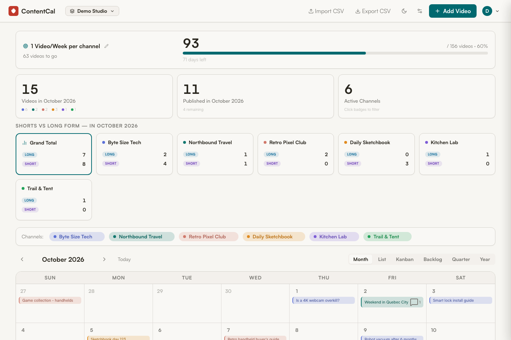
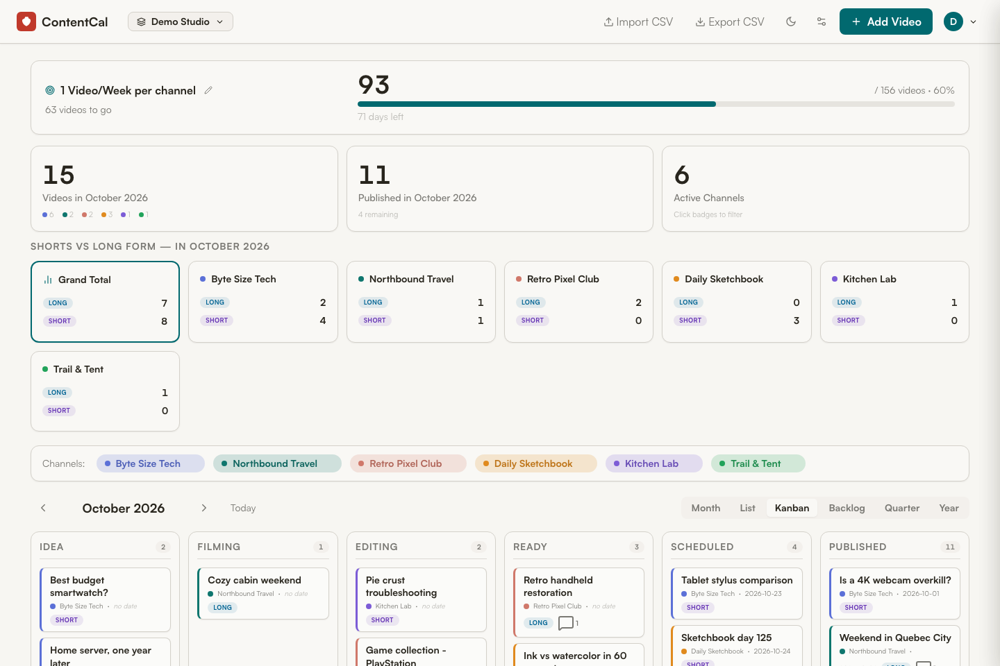
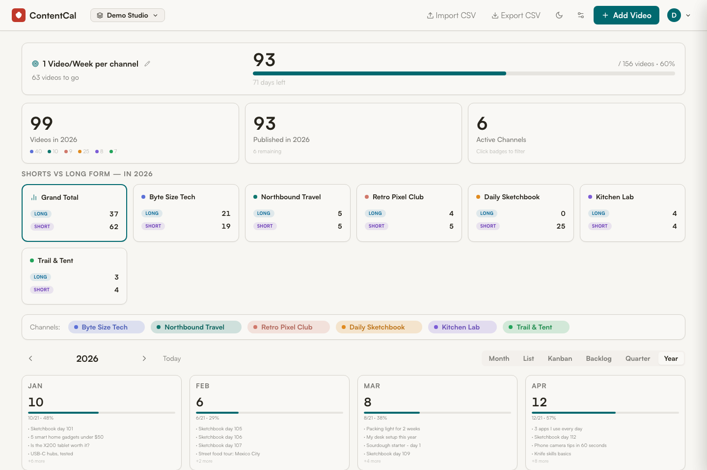
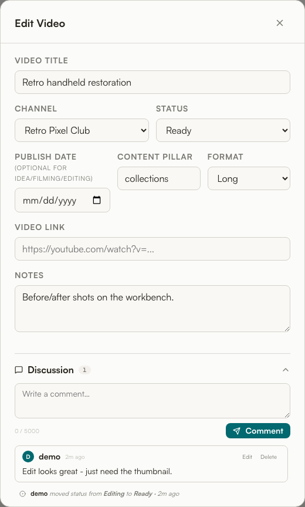
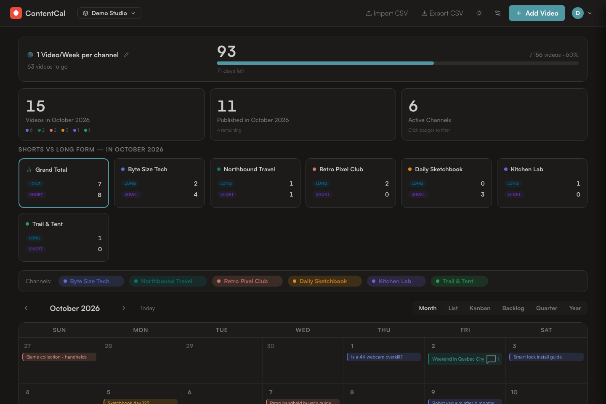

<div align="center">

# 📅 ContentCal

### A self-hosted content calendar for multi-channel YouTube creators

Plan, track, and ship videos across up to six channels — from raw idea to published — in one fast, private dashboard you run on your own NAS.

`FastAPI` · `SQLite` · `Vanilla JS` · `Docker` · No build step · No SaaS · Your data stays home

</div>



### ▶ See it in action

<video src="contentcal-demo.mp4" controls muted playsinline width="100%">
  <a href="contentcal-demo.mp4">Watch the 90-second demo (MP4)</a>
</video>

A 90-second tour with captions: signing in, the goal tracker and pipeline stats, adding a video, dragging it across the Kanban board, commenting, the List / Backlog / Year views, and dark mode. If the player doesn't show above, **[open the video directly](contentcal-demo.mp4)**.

---

## What it is

ContentCal is a lightweight, single-container web app for creators who juggle several YouTube channels at once. Every video moves through a clear pipeline — **Idea → Filming → Editing → Ready → Scheduled → Published** — and you can see your whole slate as a calendar, a board, a list, or a year-at-a-glance roll-up. It's multi-user and multi-workspace, so a small team can collaborate, comment, and hand work off.

It's built to be **self-hosted**: one Docker container, one SQLite database file, backed up by your normal NAS routine. No external services, no telemetry, no subscription.

## Why you'd use it

- **You run more than one channel** and a generic calendar doesn't understand "channels," "content pillars," or "shorts vs long-form."
- **You want to own your data** instead of renting another SaaS dashboard.
- **You work with an editor or VA** and need comments, an activity trail, and shared visibility — without giving anyone your YouTube login.
- **You think in goals** ("one video per week per channel") and want a progress bar that tracks reality against the plan.

## Highlights

| | |
|---|---|
| 🗓️ **Six ways to see your slate** | Month, List, Kanban board, Backlog, Quarter, and Year views — same data, different altitude. |
| 🎬 **Built around the creator pipeline** | Six pipeline statuses, short/long-form tagging, content pillars, publish dates, and video links per entry. |
| 🎯 **Goal tracking** | Set a target ("156 videos by year-end") and watch a live progress bar with days remaining. |
| 🟣 **Per-channel color & branding** | Up to 6 channels, each with its own color and profile image; click a channel badge to filter the whole board. |
| 🤝 **Team collaboration** | Workspaces with owner/member roles, invite links, threaded comments, and an automatic activity feed on every video. |
| ⏱️ **Auto-publish** | Scheduled videos flip to "Published" automatically once their date passes — in *your* timezone. |
| 📥 **CSV import & export** | Bring an existing spreadsheet in with a column-mapping wizard and duplicate detection; export anytime. |
| 🌙 **Dark mode + mobile** | Full responsive layout and a one-click dark theme. |
| 🔒 **Private & self-hosted** | Runs on your NAS via Docker; all data lives in a single SQLite file you control. |

## See it

| Kanban board | Year roll-up |
|---|---|
|  |  |

| Per-video discussion | Dark mode |
|---|---|
|  |  |

## Quick start

```bash
# 1. Point APPDATA at your data root (.env is never committed) and create
#    the data folder (mounted at /app/data; put calendar.db here if you're
#    moving an existing install)
echo "APPDATA=/volume1/docker/appdata" > .env
mkdir -p /volume1/docker/appdata/contentcal

# 2. Build and run
docker compose up -d --build

# 3. Open the app and create your admin account
#    http://<your-nas-ip>:8765
```

The first person to open the app runs a one-time setup wizard that creates the admin account and the first workspace. It asks for a setup code printed in the server logs, so only whoever runs the server can claim it. From there, invite teammates or spin up more workspaces.

## Tech at a glance

- **Backend** — Python 3.12, FastAPI, SQLModel over SQLite. ~1,500 lines, one file.
- **Frontend** — A single `index.html` with vanilla JavaScript. No framework, no bundler, no `node_modules`.
- **Auth** — bcrypt password hashing, signed (itsdangerous) session cookies, 30-day sessions, login throttling, invite-only sign-up.
- **Tests** — ~140 pytest regression tests covering auth, workspace isolation, roles, invites, concurrency, and cascade deletes. A pre-push git hook runs them before every push.
- **Deploy** — One Docker container behind whatever reverse proxy / Tailscale setup you already have.

## Documentation

- 📘 **[User Guide](USER_GUIDE.md)** — for creators and team members. How to plan and track videos, no technical knowledge needed.
- 🛠️ **[Developer Guide](DEVELOPER_GUIDE.md)** — architecture, data model, API reference, and how to run/extend it.

---

<div align="center">
<sub>Self-hosted · Single container · Your data, your server.</sub>
</div>
