# 📅 ContentCal — User Guide

A friendly, no-jargon guide to planning your YouTube videos with ContentCal. If you can use a calendar app, you can use this.

> 🎬 **New here?** [Watch the 90-second demo](contentcal-demo.mp4) first. It walks through the same steps as sections 2–6 below.

---

## Table of contents

1. [What ContentCal does for you](#1-what-contentcal-does-for-you)
2. [Signing in](#2-signing-in)
3. [The dashboard at a glance](#3-the-dashboard-at-a-glance)
4. [Adding your first video](#4-adding-your-first-video)
5. [The video pipeline (statuses)](#5-the-video-pipeline-statuses)
6. [The six views](#6-the-six-views)
7. [Setting up your channels](#7-setting-up-your-channels)
8. [Setting a goal](#8-setting-a-goal)
9. [Working with a team](#9-working-with-a-team)
10. [Comments & history on a video](#10-comments--history-on-a-video)
11. [Importing and exporting](#11-importing-and-exporting)
12. [Handy extras](#12-handy-extras)
13. [FAQ](#13-faq)

---

## 1. What ContentCal does for you

ContentCal is a planning board for people who make videos for **more than one YouTube channel**. Instead of scattering ideas across notes apps and spreadsheets, every video lives in one place and moves through clear stages — from a rough idea, through filming and editing, to scheduled and finally published.

You get a calendar, a drag-and-drop board, progress toward your goals, and (if you work with an editor or assistant) a shared space to comment and hand off work.

---

## 2. Signing in

When you open ContentCal you'll see a login screen. Enter your username and password.

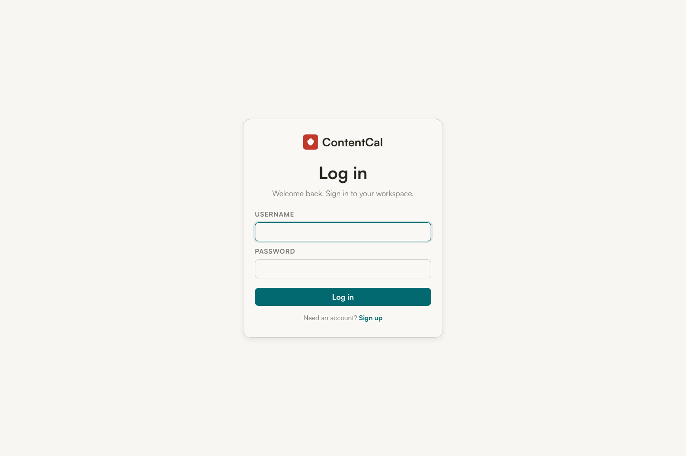

- **First time the app is ever opened?** You'll instead see a short setup screen to create the very first account — that account becomes the admin. It asks for a **setup code**, which whoever runs the server finds in its logs (`docker logs contentcal`).
- **Need an account?** Ask a workspace owner for an invite link and open it — that takes you to sign-up. (If your server has open sign-up turned on, there's also a **Sign up** link on the login screen.)
- **Change your password** from the account menu (your initials, top right). Every other device is signed out.

---

## 3. The dashboard at a glance

Once you're in, the top of the screen gives you a quick read on how you're doing:

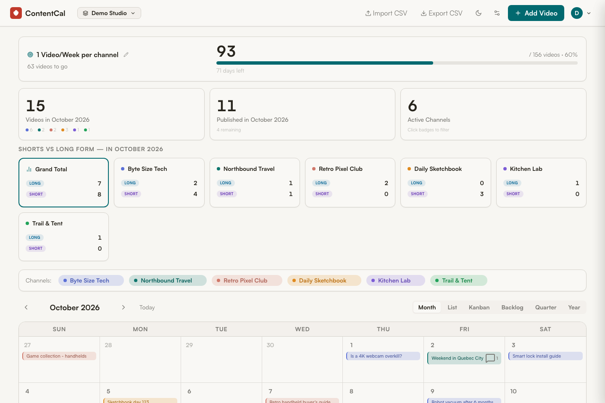

- **Goal banner** (top) — your target and a progress bar. Here it shows *88 / 156 videos · 56%* with *200 days left*.
- **Stat cards** — videos this month, how many are published, and how many channels are active.
- **Shorts vs Long-form** — a breakdown so you can balance quick Shorts against longer videos.
- **Channel badges** — one colored pill per channel. **Click a badge to show or hide that channel** everywhere on the page — great for focusing on one channel at a time.
- **View tabs** (Month / List / Kanban / Backlog / Quarter / Year) — switch how your videos are displayed.

---

## 4. Adding your first video

Click the green **+ Add Video** button (top right). A form pops up:

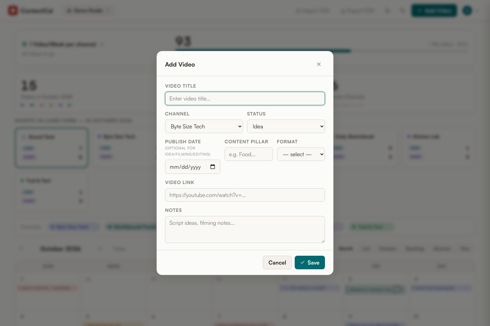

Fill in what you know — only the title is required:

| Field | What to put |
|---|---|
| **Video Title** | The working title of the video. |
| **Channel** | Which of your channels it's for. |
| **Status** | Where it is in the pipeline (Idea, Filming, etc.). |
| **Publish Date** | When it goes live. *Optional* for early-stage videos — leave it blank and it waits in your Backlog. *Required* once you mark it Scheduled or Published. |
| **Content Pillar** | The theme/category (e.g. "review", "travel"). |
| **Format** | Long-form or Short. |
| **Video Link** | The YouTube URL, once it exists. |
| **Notes** | Script ideas, shot lists, reminders — anything. |

Click **Save** and it appears on your calendar (or in the Backlog if you didn't give it a date).

---

## 5. The video pipeline (statuses)

Every video has a **status** showing how far along it is. There are six, in order:

**Idea → Filming → Editing → Ready → Scheduled → Published**

- **Idea** — a concept you haven't started yet.
- **Filming** — currently shooting.
- **Editing** — in the edit.
- **Ready** — edited and waiting for a slot.
- **Scheduled** — has a publish date locked in.
- **Published** — live on YouTube.

> 💡 **Auto-publish:** Once a *Scheduled* video's date arrives, ContentCal automatically flips it to **Published** for you — using your workspace's timezone so it happens at the right local moment.

---

## 6. The six views

The same videos, shown six different ways. Switch with the tabs above the calendar.

### 🗓️ Month
The classic calendar grid. See what's going out each day. Click any video to open it.

### 📋 List
A clean, chronological list grouped by week — good for scanning what's coming and which videos still need a link.

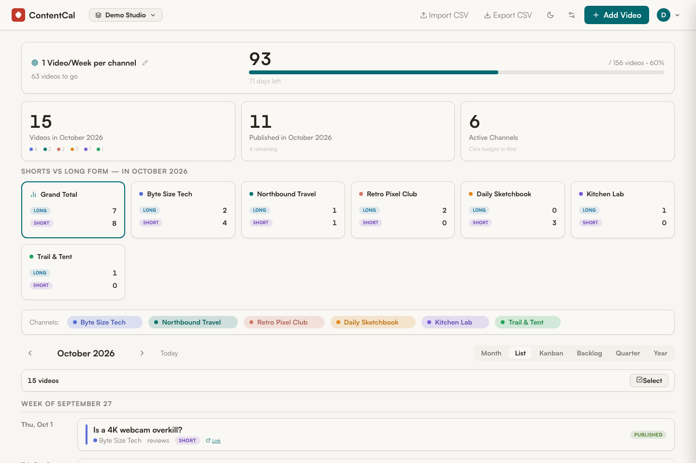

### 🟦 Kanban
A board with a column for each status. **Drag a video from one column to another to change its status** — for example, drag a card from *Editing* to *Ready* when you finish the edit.

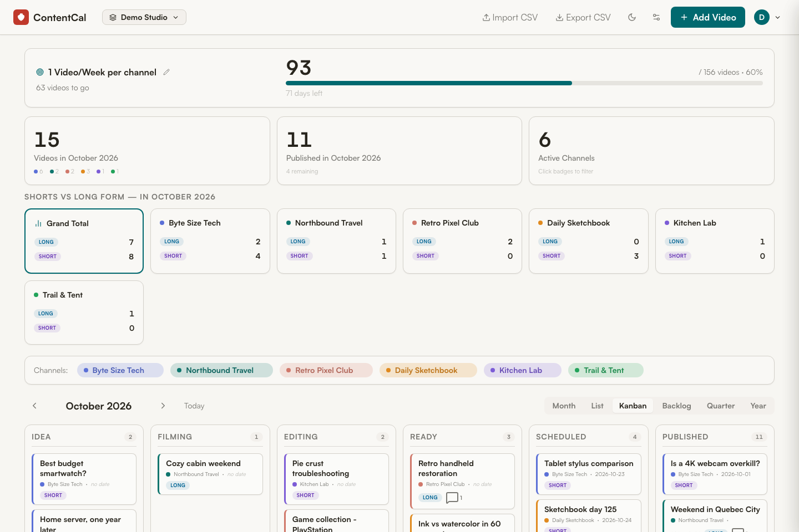

### 📥 Backlog
Your parking lot for ideas **without a date yet**. Capture a thought here, and when you're ready to schedule it, just add a date and it moves onto the calendar.

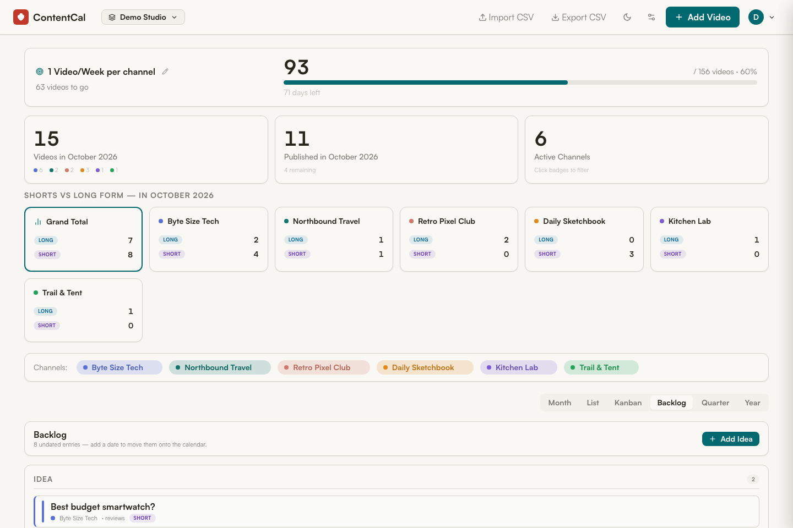

### 📆 Quarter & 📅 Year
Zoomed-out roll-ups. The **Quarter** view shows the three months side by side, with every video listed under its month.

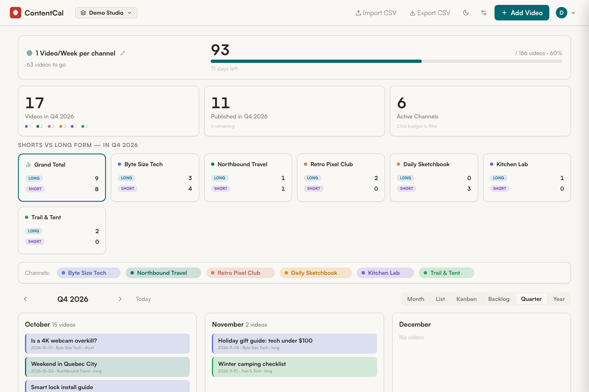

The **Year** view shows each month's count and a progress bar, so you can spot busy stretches and quiet gaps across the whole year.

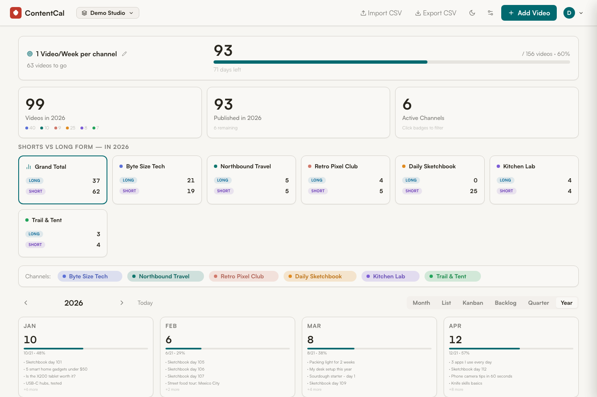

> On a phone, ContentCal automatically simplifies the layout so everything stays tappable. On the Kanban board, swipe sideways to move between status columns.
>
> | List | Kanban |
> |---|---|
> | 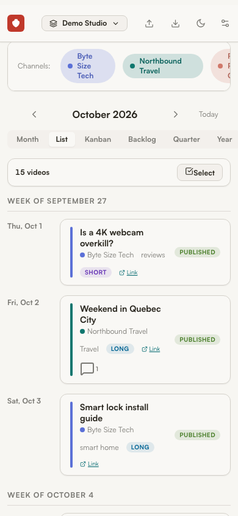 | 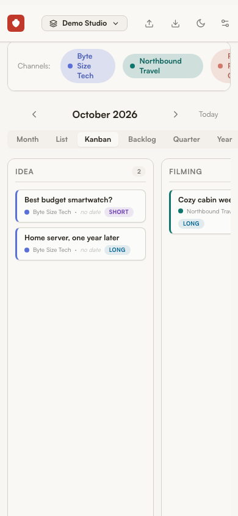 |

---

## 7. Setting up your channels

Click the **settings (⚙︎) icon** in the top bar to open **Manage Channels**. Only workspace owners can manage channels, so members don't see this button.

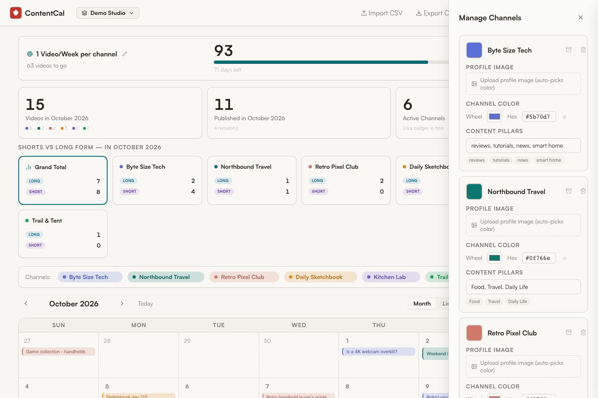

For each channel (up to **6**) you can set:

- **Name** — e.g. "Byte Size Tech".
- **Profile image** — upload a logo; ContentCal can auto-pick a matching color from it.
- **Channel color** — pick your own, or let it auto-pick. This color is used on badges and calendar entries.
- **Content Pillars** — your recurring themes for that channel (type them comma-separated). These show up as quick options when you create a video.

Click **Save Channel Changes** when you're done.

---

## 8. Setting a goal

A goal keeps you honest (owners only). Click the **pencil** next to the goal banner (or **Set a Goal** if you haven't yet) and enter:

- **Goal name** — e.g. "1 Video/Week per channel".
- **Target** — the number of published videos you're aiming for.
- **Deadline** — the date you want to hit it by.

The banner then shows your published count, percentage, and how many days remain — updating automatically as you publish.

---

## 9. Working with a team

ContentCal is built for small teams. Your videos live inside a **workspace**, and you can invite others to it.

Open **Workspace settings** from the account menu (top-right):

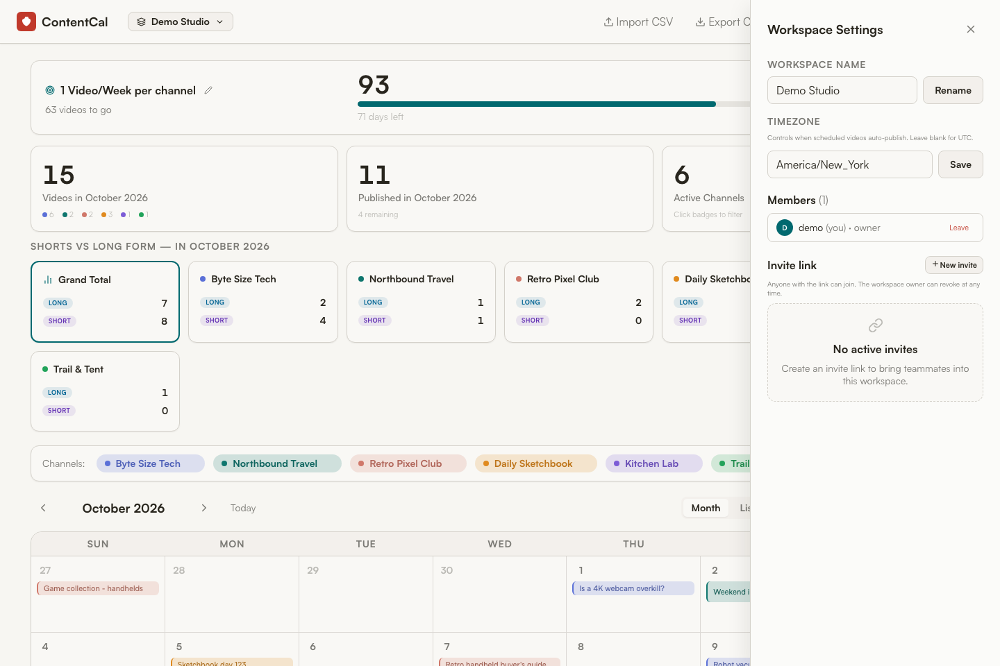

- **Rename** your workspace.
- **Timezone** — set this so auto-publish happens at the right local time.
- **Members** — see everyone in the workspace and their role.
- **Invite link** — click **New invite** to generate a link. Anyone who opens it can join. You can set it to expire after a number of days, and revoke it anytime.

**Roles:**
- **Owner** — can rename the workspace, manage channels and the goal, manage members, create/revoke invites, and moderate comments.
- **Member** — can do everything with videos (add, edit, comment) but not change channels, the goal, or the workspace.

You can belong to several workspaces (e.g. a personal one and a team one) and switch between them using the workspace dropdown in the top-left.

---

## 10. Comments & history on a video

Open any video and expand the **Discussion** section to collaborate:

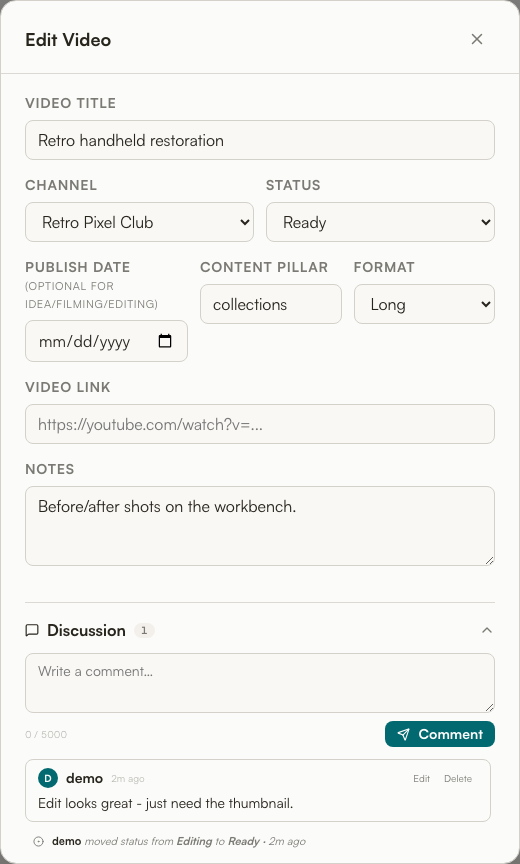

- **Comments** — leave notes for teammates ("Just need the thumbnail"). Edit or delete your own.
- **Activity history** — ContentCal automatically records key changes, like *"admin moved status from Editing to Ready."* So you always know what changed and when, without anyone having to write it down.

The little 💬 badge on a calendar card tells you a video has comments.

---

## 11. Importing and exporting

Already have your plan in a spreadsheet? Use **Import CSV** (top bar).

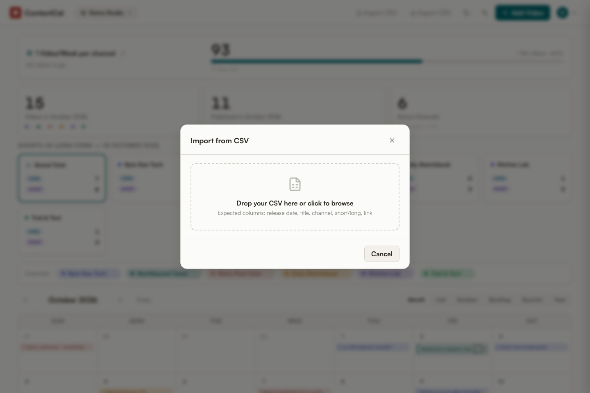

- Drag your file in (or click to browse). Expected columns are *release date, title, channel, short/long, link*.
- A wizard lets you **map your spreadsheet's columns** to ContentCal's fields, so your headings don't have to match exactly.
- It flags likely **duplicates** before importing so you don't double up.

**Export CSV** downloads your whole calendar anytime — handy for backups or sharing.

---

## 12. Handy extras

- **Dark mode** — click the moon icon in the top bar.

  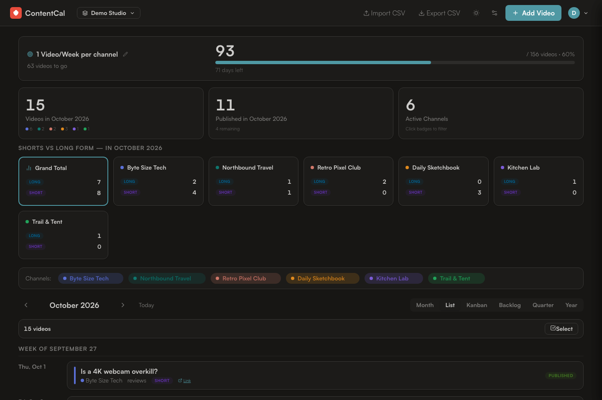

- **Bulk edit** — in List view, click **Select** to tick multiple videos and change their status, channel, or format all at once (or delete them together).
- **Today button** — jumps the calendar back to the current date.
- **Filtering** — remember, clicking channel badges hides/shows channels across every view.

---

## 13. FAQ

**Do I need the internet?**
Only to reach the server it's running on. ContentCal itself doesn't depend on any outside service.

**What happens to a Scheduled video when its date arrives?**
It automatically becomes Published — in your workspace's timezone.

**Can I have a video with no date?**
Yes — leave the date blank and it lives in the **Backlog** until you're ready to schedule it. (Dates become required once a video is Scheduled or Published.)

**How many channels can I have?**
Up to 6 per workspace.

**Is my data safe if two people edit at once?**
Yes. If someone reorders or changes channels while you're editing, ContentCal will ask you to refresh rather than letting one person's change quietly overwrite another's.

**Why did logging out sign me out on my other devices too?**
That's on purpose: logging out (or changing your password) signs your account out everywhere, so a lost or shared device can't stay logged in.

**It says "Too many attempts". What now?**
After several wrong passwords, ContentCal pauses sign-in for a few minutes. Wait, then try again. A browser you've signed in with before isn't affected by someone else guessing at your account.

**Where does my data live?**
In a single database file on the server you (or your admin) run. Ask your admin about backups.

---

*Need the technical details — APIs, deployment, architecture? See the [Developer Guide](DEVELOPER_GUIDE.md).*
